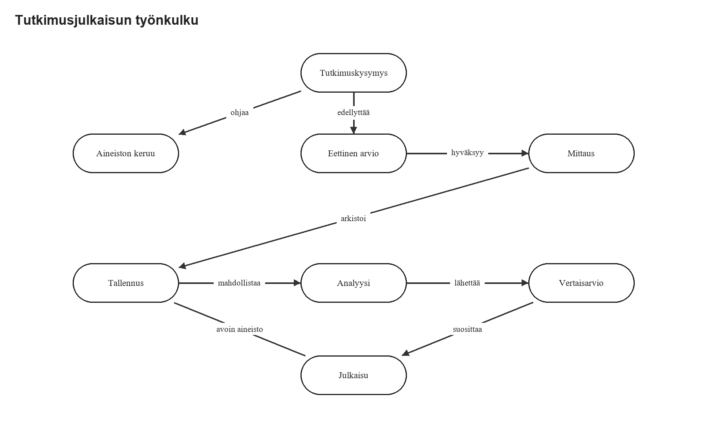
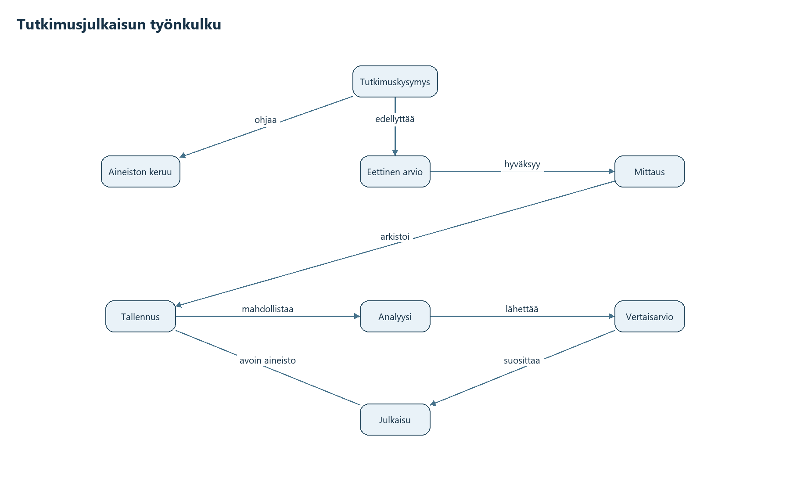

# What happened in our graph-reading test?

**One-file version:** [Download the illustrated PDF](finnish_diagram_extraction_findings.pdf). These are informal experiment notes, not a research paper.

We reran the ten clean, synthetic Finnish-context diagrams after finding that several v3 source links were hidden by nodes or coincident with other links. The corrected set contains **83 nodes, 105 visible edges, and 198 printed text regions**. Its source PNGs pass automated checks for text clipping, text overlap, edge occlusion by unrelated nodes, and coincident edge routes. The earlier v3 graph error rates are superseded.

## Corrected matrix

| Approach | Task | Scorer events / 198 | Exact figures | Main events |
|---|---|---:|---:|---|
| RapidOCR PP-OCRv6 Finnish | Printed text | **16 (8.1%)** | 6/10 | 2 edge-label errors; 14 unmatched boxes |
| PaddleOCR PP-OCRv5 Finnish | Printed text | 57 (28.8%) | 1/10 | 19 edge-label errors; 38 unmatched boxes |
| Older RapidOCR baseline | Printed text | 60 (30.3%) | 0/10 | 7 title, 17 node, 36 edge-label errors |
| Blind Codex vision | Graph | 16 (8.1%) | 8/10 | 16 strict node-shape category mismatches |
| Blind Codex + RapidOCR | Graph | **8 (4.0%)** | 9/10 | 8 strict node-shape category mismatches |
| Vision + deterministic OCR evidence | Graph | 16 (8.1%) | 8/10 | Same vision graph; OCR only attached as evidence |

Every row divides by the same **198 source items** (10 titles, 83 nodes, 105 edges), with extra outputs added to the numerator. OCR rows test printed text and its location; graph rows test complete graph elements. These percentages therefore compare methods **within the same task**, not OCR against vision as if they produced the same output. The shape-category mismatches concern ellipse versus pill, and pill versus rounded rectangle. They are strict taxonomy differences; the figures remain visually rounded in both versions.

## Error breakdown

| Check | Image-only vision | Image + RapidOCR | What it means |
|---|---:|---:|---|
| Missing or extra nodes | 0 | 0 | All 83 node positions were matched. |
| Wrong title or node text | 0 | 0 | Printed titles and node labels matched exactly. |
| Missing or extra edge records | 0 | 0 | All 105 source endpoint pairs were matched. |
| Wrong edge label, arrowhead, or stroke | 0 | 0 | Printed relationships and visible marks matched. |
| Node-shape category mismatch | 16 | 8 | Rounded shapes received a different strict type label. |
| Arrowless semantic direction left unknown | 0 | 8 | No arrowhead was visible, so these are *not* visual arrow errors. |

The independent fusion run saw the anonymous images **and raw RapidOCR PP-OCRv6 medium Finnish observations**. Its lower shape-event count cannot be attributed to OCR from one run: the two fresh agents may simply have made different visual judgments. The deterministic union matched OCR text to the saved image-only graph without changing nodes or edges; its identical graph score is expected.

The corrected set no longer supports the earlier claim that most tested diagrams failed review-free reconstruction. Under this scorer, **both blind runs matched all 105 visible edge records**. The test remains small and synthetic, with crisp generated images, exact instructions, and procedural rather than filesystem-enforced blinding. It cannot establish a universal error rate or semantic truth beyond what the diagrams print. A cautious real-world workflow should still retain the image, OCR observations, predictions, and uncertainties for review.

| Corrected source | Blind image-only reconstruction |
|---|---|
|  |  |

Browse [all ten source / vision / fusion comparisons](benchmark_v4/results_viewer.html), the [full validation report](benchmark_v4/REPORT.md), [matrix CSV](benchmark_v4/approach_matrix.csv), and [item-level ledger](benchmark_v4/item_error_ledger.json). The old v3 data remains available as a record of the source-graph flaw.
