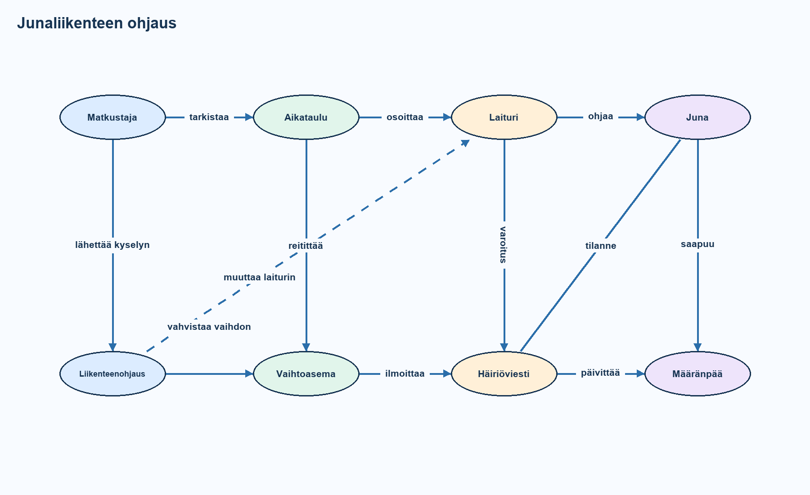
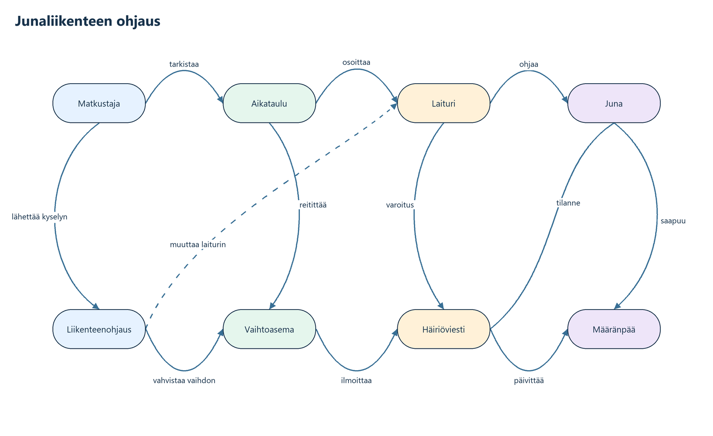
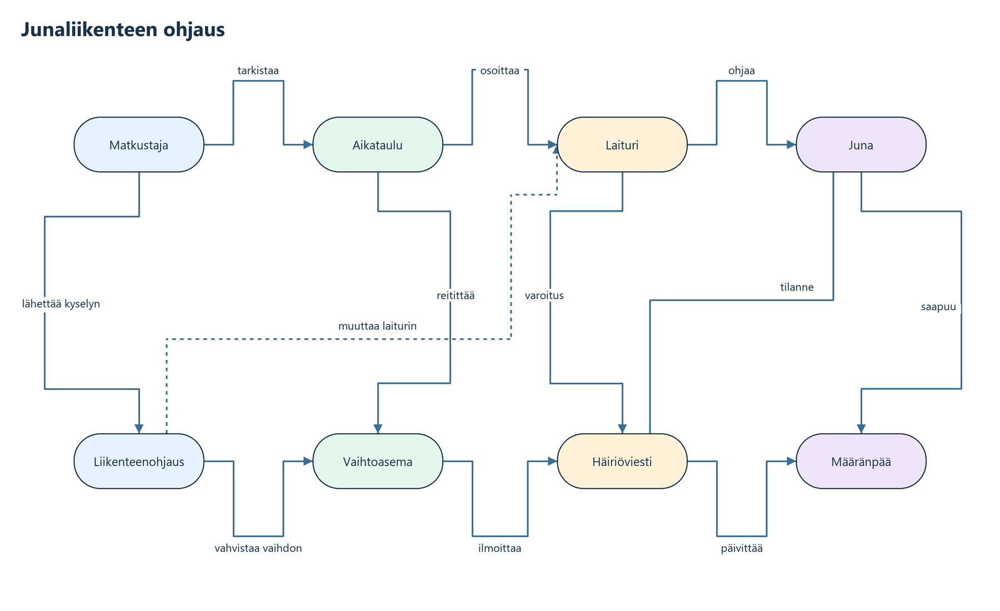

# What happened in our graph-reading test?

**One-file version:** [Download the illustrated PDF](finnish_diagram_extraction_findings.pdf). These are informal experiment notes, not a research paper.

We tested twelve clean Finnish-context diagram images, including straight, curved, and right-angle renderings of one rail graph. The three rail images share graph content and are paired examples rather than independent graphs.

The twelve images contain **99 node instances, 129 edge instances, and 240 printed text regions**. Source QA found 0 clipped labels, 0 overlapping text regions, 0 links obstructed by unrelated nodes, and 0 coincident route pairs. The routed paths also passed their geometric checks.

## Results matrix

| Approach | Output | Scorer events / 240 | Exact figures | Main event types |
|---|---|---:|---:|---|
| RapidOCR PP-OCRv6 Finnish | OCR text | **17 (7.1%)** | 7/12 | 0 title, 0 node, 2 edge text errors; 15 unmatched boxes |
| PaddleOCR PP-OCRv5 Finnish | OCR text | **57 (23.8%)** | 3/12 | 0 title, 0 node, 19 edge text errors; 38 unmatched boxes |
| Older RapidOCR baseline | OCR text | **74 (30.8%)** | 0/12 | 9 title, 23 node, 42 edge text errors; 0 unmatched boxes |
| Blind Codex vision | Graph | **20 (8.3%)** | 7/12 | 18 shape mismatches; 1 wrong arrows; 1 wrong strokes |
| Blind Codex + RapidOCR | Graph | **12 (5.0%)** | 8/12 | 8 shape mismatches; 3 wrong arrows; 1 wrong strokes |
| Vision + deterministic OCR evidence | Graph | **20 (8.3%)** | 7/12 | 18 shape mismatches; 1 wrong arrows; 1 wrong strokes |

Every row uses 240 source items as the denominator (12 titles, 99 nodes, 129 edges); extra outputs add events to the numerator. OCR rows score printed text. Graph rows score nodes and complete edges. Their percentages describe different tasks and should not be ranked against each other as if they produce the same output.

## Paired route results

| Approach | Straight events / 21 | Curved events / 21 | Right-angle events / 21 |
|---|---:|---:|---:|
| RapidOCR PP-OCRv6 Finnish | 1 | 0 | 1 |
| PaddleOCR PP-OCRv5 Finnish | 5 | 0 | 0 |
| Older RapidOCR baseline | 8 | 7 | 7 |
| Blind Codex vision | 8 | 0 | 0 |
| Blind Codex + RapidOCR | 9 | 1 | 1 |
| Vision + deterministic OCR evidence | 8 | 0 | 0 |

These are three renderings of **one** graph. The straight figure uses oval nodes while the routed figures use pill nodes; line and label placement differ too. This is a paired topology comparison, not an isolated route-shape test. It does not establish a general error rate for curved arrows or prove that OCR caused a fusion change. The prediction schema records graph connections, not the exact pixel path, so route reproduction itself is not scored.

The blind image-only run and the independent image-plus-RapidOCR run saved predictions before scoring. The fusion run saw raw RapidOCR PP-OCRv6 medium Finnish observations. A deterministic evidence union kept the image-only graph unchanged and merely attached OCR boxes, so its graph score is identical by design. Arrowless links labeled semantically unknown were counted as visually faithful, not as arrow mistakes.

| Straight baseline | Curved arrows | Right-angle detours |
|---|---|---|
|  |  |  |

Browse the [12-case source / vision / fusion viewer](benchmark_v5/results_viewer.html), [full validation report](benchmark_v5/REPORT.md), [approach matrix](benchmark_v5/approach_matrix.csv), [paired route results](benchmark_v5/paired_results.csv), and [item-level ledger](benchmark_v5/item_error_ledger.json). This clean synthetic experiment does not test real-world semantic truth or a universal reliability rate.
