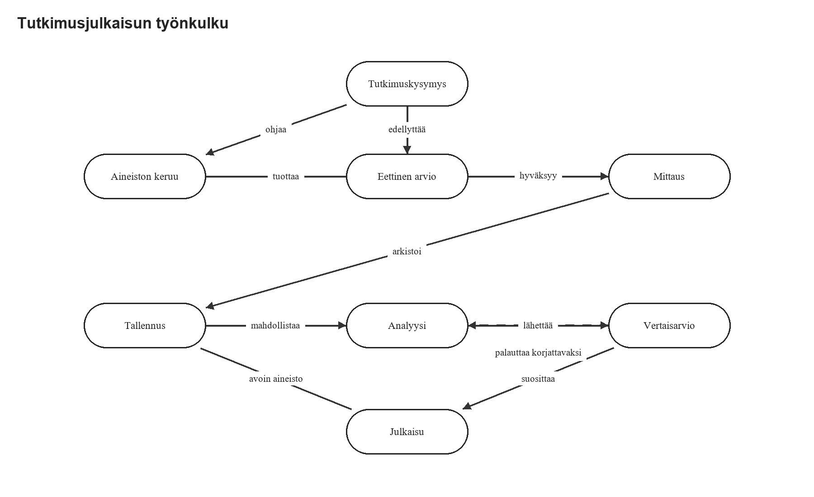
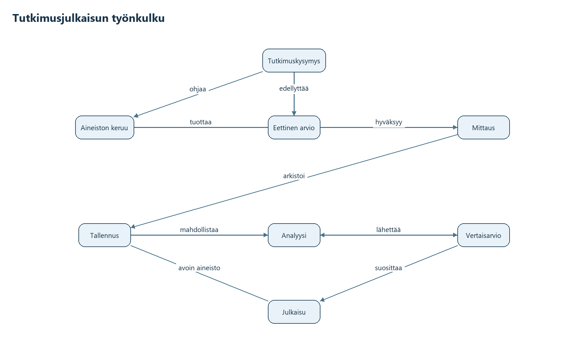

# Can OCR and AI vision reliably reconstruct diagrams?

**Share this report as one file:** [Download the self-contained PDF](finnish_diagram_extraction_findings.pdf). It includes the matrix and example diagrams without requiring access to this repository.

These are informal notes from a small experiment, not a research paper. We tested ten clean, synthetic Finnish-context diagrams with varied layouts, shapes, fonts, colors, arrow styles, and edge labels. Together they contain **83 nodes, 113 edges, and 206 printed text regions**. The test asks whether an image can be turned into a complete graph without a human checking it.

**Observed answer for this set: no.** The best OCR engine read most text, but OCR alone did not produce connections or arrow directions. Blind Codex vision reconstructed only **4 of 10 figures without a scored error**. Adding deduplicated OCR observations to that saved vision graph left the graph result at **4 of 10**. This is a result for these ten diagrams, not an estimate for all figures.

## Results matrix

| Approach | Output scored | Total errors / 206 source items | Error-free figures / 10 | Key result |
|---|---|---:|---:|---|
| RapidOCR PP-OCRv6 medium Finnish | Printed text | **18 (8.7%)** | 4 | 203/206 text regions exact; 15 unmatched OCR boxes |
| PaddleOCR PP-OCRv5 Finnish | Printed text | 59 (28.6%) | 0 | 187/206 text regions exact; 40 unmatched OCR boxes |
| Older RapidOCR baseline | Printed text | 61 (29.6%) | 0 | 145/206 text regions exact; 0 unmatched OCR boxes |
| Blind Codex vision | Complete graph | **26 (12.6%)** | 4 | 83/83 nodes and 105/113 connections found; 101/113 edges fully correct |

Every row uses **206 source items as the denominator**: 10 titles, 83 nodes, and 113 edges. Extra outputs add errors to the numerator. The OCR rows score text regions; the vision row scores graph elements, including node shape and full edge properties. Their percentages therefore measure **different tasks**. Compare OCR engines with one another; an 8.7% OCR text error rate does **not** mean RapidOCR reconstructs graphs better than vision.

| Graph metric | Blind vision |
|---|---:|
| Node precision / recall | 100% / 100% |
| Connection precision / recall | 96.3% / 92.9% |
| Fully correct edges | 101/113 |

**Precision** is the share of reported items that match the source; **recall** is the share of source items found. Connection matching checks endpoints. A *fully correct edge* also requires the arrow direction, printed relationship label, and dashed/solid stroke to match. The detailed per-type rates in the full matrix can overlap on the same edge, so they must not be added together.

### What went wrong in the blind-vision graph?

These are the **26 non-overlapping entries** in the item-level error ledger:

| Error | Count | What it means |
|---|---:|---|
| Wrong node shape | 10 | The node's text was correct, but its visible shape was misclassified. |
| Missed connection | 8 | A link visible in the source was left out. |
| Extra connection | 4 | A link was reported where the source had none. |
| Wrong edge label | 2 | The printed relationship on a matched link was read incorrectly. |
| Wrong arrow direction | 2 | A matched link pointed the wrong way. |

No matched link had the wrong dashed/solid stroke style. The detailed scorer's 8/113 stroke *incomplete* rate counts the eight omitted links, whose stroke could not be checked. The same omitted links also contribute to the per-type arrow and label rates; the ledger table above avoids counting them repeatedly.

## Example: source and blind reconstruction

The source below is the research-publication workflow. Vision recovered its labels and most connections, but classified all eight pill-shaped nodes as another shape and missed or misread some edge details.

| Source figure | Blind Codex vision reconstruction |
|---|---|
|  |  |

See the [interactive side-by-side viewer](benchmark_v3/results_viewer.html) for all ten figures, and the [source image folder](benchmark_v3/) for other styles. GitHub may download the HTML viewer rather than run it; it also works as a local file.

## What the combined approach did

The saved **deterministic OCR evidence union** is not a second graph prediction. It matched each exact-text RapidOCR box to at most one existing vision element, kept unmatched boxes as evidence, and did not add nodes or edges. Its graph accuracy is identical to blind vision **by construction**, so it is omitted from the primary accuracy table. Its separate row remains in the [full machine-readable matrix](benchmark_v3/approach_matrix.csv) for traceability. A historical Codex session that saw both images and OCR is retained in the [full validation report](benchmark_v3/REPORT.md); it was a different experiment.

The images were generated from known graphs and checked for visible text. The blind vision prediction was saved before scoring; the task access audit is [here](benchmark_v3/session_audit.json). The set is small and synthetic, and image matching in the scorer uses position tolerances. These results show that **review-free reconstruction failed on most of the tested diagrams**; they do not establish a universal failure rate or test semantic truth beyond what the figures visibly state.

Full data: [machine-readable matrix](benchmark_v3/approach_matrix.csv) · [item-level error ledger](benchmark_v3/item_error_ledger.json) · [validation report](benchmark_v3/REPORT.md) · [Mermaid sources and graph truth](benchmark_v3/README.md).
